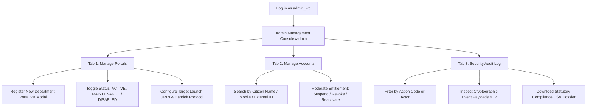

# West Bengal SSO — System Administrator Operational Manual

This comprehensive guide details the complete functionality, architecture, and step-by-step workflows executed by a **System Administrator** (`userType: 'ADMIN'`) within the **West Bengal Labour Department Single Sign-On (SSO)** gateway.

---

## 1. Role Overview & Responsibilities

The **System Administrator** holds root governance privileges across the unified identity federation gateway. While `APPLICANT` users apply for statutory licences and `OFFICER` users inspect and adjudicate dossiers, the **System Admin** is responsible for:

1. **Department Portal Gateway Management**: Onboarding, updating, and moderating integrated departmental portals (e.g., Factories Directorate, Silpasathi Single Window, Directorate of Boilers, Shramik Suraksha).
2. **Citizen & Staff Account Entitlement Governance**: Managing unified identity mappings, suspending compromised accounts, and revoking unauthorized portal permissions.
3. **Statutory Security & Forensics**: Reviewing immutable audit ledgers, monitoring cryptographic handoff tokens, and exporting CSV compliance dossiers for CERT-In / West Bengal State Cyber Security Cell reviews.
4. **Maintenance & Disaster Recovery**: Putting departmental portals into scheduled maintenance or emergency disabled mode without taking down the central identity hub.

---

## 2. Administrator Access & Credentials

### Default Development Admin Account
| Field | Credential / Configuration |
|---|---|
| **Full Name** | Sri Subrata Roy (System Admin) |
| **Username** | `admin_wb` |
| **Registered Mobile** | `9830000001` |
| **Password** | `Admin@WB2026` |
| **Test OTP** | `123456` |
| **User Role** | `ADMIN` |
| **Admin Console Route** | `http://localhost:5173/admin` |
| **API Base URL** | `http://localhost:3000/api/v1/admin` |

### How to Log In as System Admin:
1. Open the SSO web portal (`http://localhost:5173`).
2. Log in using either:
   - **Password Mode**: Username `admin_wb`, Password `Admin@WB2026`.
   - **Mobile OTP Mode**: Mobile `9830000001` &rarr; Dispatched to `+91 XXXXXX0001` &rarr; OTP `123456`.
3. Upon authentication, an **Admin Console** link with a shield icon appears in the primary navigation header. Click it or navigate directly to `/admin`.

---

## 3. Step-by-Step Administrator Workflows



---

### Step 1: Registering a New Departmental Portal

The West Bengal SSO platform features **purely configuration-driven portal federation**. Adding a new directorate, statutory board, or external service (e.g. *Directorate of Boilers*, *Silpasathi*, *Shramik Suraksha*) never requires frontend code deployment.

---

#### 1. Method A: Registering via the Admin Console UI

1. **Log in as System Admin**:
   - Access `http://localhost:5173` with username `admin_wb` or mobile `9830000001`.
   - In the top navigation bar, click the **Admin Console** tab (or browse directly to `http://localhost:5173/admin`).
2. **Open the Registration Modal**:
   - On the **Manage Portals** tab, click the orange **+ Add Portal** button in the header.
3. **Fill in the Configuration Fields**:

| Form Field | Type | Required | Description & Practical Example |
|---|---|---|---|
| **Portal Slug** | `string` | **Yes** | Unique, lowercase URL-safe identifier without spaces. <br>• *Example:* `wb_boiler` or `wb_labour_welfare` |
| **Display Sort Order** | `number` | No | Sorting sequence number for card display on user dashboards. Lower numbers appear first. <br>• *Example:* `1` |
| **Portal Name (English)** | `string` | **Yes** | Official English departmental title. <br>• *Example:* `Directorate of Boilers` |
| **Portal Name (Bengali)** | `string` | No | Official title in Bengali script (falls back to English if blank). <br>• *Example:* `বয়লার অধিকার` |
| **Description (English)** | `string` | No | Clear summary of services and statutory scope. <br>• *Example:* `Pressure vessel inspections, safety certification & statutory boiler licence renewals` |
| **Base URL** | `url` | No | Root web application domain of the departmental system. <br>• *Example:* `http://localhost:4003` or `https://boilers.wblabour.gov.in` |
| **Target Launch URL** | `url` | **Yes** | Destination callback endpoint that receives the signed SSO token. <br>• *Example:* `http://localhost:4003/sso/callback` |
| **SSO Linking Protocol** | `select` | **Yes** | Integration handshake protocol: <br>• `SIGNED_TOKEN_HANDOFF` *(Default & Recommended)*: 60-second RS256 cryptographically signed single-use JWT with replay protection. <br>• `OIDC_FEDERATION`: Standard OpenID Connect / OAuth2 exchange. <br>• `CONSENT_LINK`: Explicit citizen consent handshake. |
| **Initial Status** | `select` | **Yes** | Initial operational state: `ACTIVE`, `MAINTENANCE`, or `DISABLED`. |
| **Allowed User Types** | `checkboxes` | **Yes** | Controls dashboard discovery and entitlement gating: <br>• `APPLICANT`: Citizens, business owners, factory occupiers. <br>• `OFFICER`: Departmental inspectors, commissioners, staff. |

4. **Submit**: Click **Register Portal**.
   - The portal record is immediately created in the database.
   - An immutable audit trail entry (`ADMIN_PORTAL_CREATE`) is logged.
   - The modal closes, and the new portal appears instantly in the directory table.

---

#### 2. Method B: Registering via REST API (cURL / Backend Script)

Administrators and automated CI/CD pipelines can also register portals via the API:

```bash
curl -X POST http://localhost:3000/api/v1/admin/portals \
  -H "Content-Type: application/json" \
  -H "Cookie: sso_session_id=<ADMIN_SESSION_ID>" \
  -d '{
    "slug": "wb_boiler",
    "nameEn": "Directorate of Boilers",
    "nameBn": "বয়লার অধিকার",
    "descriptionEn": "Statutory pressure vessel inspection & certification dossier",
    "descriptionBn": "সংবিধিবদ্ধ বয়লার পরিদর্শন শংসাপত্র ও পুনর্নবীকরণ",
    "iconKey": "Flame",
    "baseUrl": "http://localhost:4003",
    "launchUrl": "http://localhost:4003/sso/callback",
    "linkingMethod": "SIGNED_TOKEN_HANDOFF",
    "status": "ACTIVE",
    "allowedUserTypes": ["APPLICANT", "OFFICER"],
    "sortOrder": 3
  }'
```

**Successful Response (`201 Created`):**
```json
{
  "id": "e4f8a29b-813c-4a30-8a12-87db34e56912",
  "slug": "wb_boiler",
  "nameEn": "Directorate of Boilers",
  "nameBn": "বয়লার অধিকার",
  "descriptionEn": "Statutory pressure vessel inspection & certification dossier",
  "descriptionBn": "সংবিধিবদ্ধ বয়লার পরিদর্শন শংসাপত্র ও পুনর্নবীকরণ",
  "iconKey": "Flame",
  "baseUrl": "http://localhost:4003",
  "launchUrl": "http://localhost:4003/sso/callback",
  "linkingMethod": "SIGNED_TOKEN_HANDOFF",
  "status": "ACTIVE",
  "allowedUserTypes": ["APPLICANT", "OFFICER"],
  "sortOrder": 3
}
```

---

#### 3. How the Destination Portal Consumes the Handoff Token

When an authorized citizen or officer clicks **Launch Portal** on their dashboard, the SSO gateway executes the following cryptographically secure handshake:

1. **Launch Redirect**: The browser is redirected to the configured `launchUrl`:
   ```text
   GET https://boilers.wblabour.gov.in/sso/callback?token=<RS256_SIGNED_JWT>
   ```
2. **Signature Verification**:
   The destination portal fetches the central SSO public keys from `http://localhost:3000/.well-known/jwks.json` to verify the cryptographic RS256 signature.
3. **Payload Claims Validation**:
   The verified JWT payload contains:
   ```json
   {
     "sub": "f910ff96-1cf5-460a-8d4d-1de339f76047",
     "portal_user_id": "BOILER-LIC-2026-991",
     "portal_role": "Boiler Occupier / Engineer",
     "aud": "wb_boiler",
     "jti": "7a3f4e19-5d2b-42e1-95c0-10ab9e432c78",
     "iat": 1776074400,
     "exp": 1776074460
   }
   ```
4. **Single-Use Burn (Anti-Replay Protection)**:
   The destination portal calls the central verification endpoint to mark the token as consumed:
   ```bash
   POST http://localhost:3000/api/v1/portals/verify-handoff
   Content-Type: application/json

   {
     "jti": "7a3f4e19-5d2b-42e1-95c0-10ab9e432c78",
     "portalSlug": "wb_boiler"
   }
   ```
   If valid, the central API sets `usedAt = NOW()`, permanently burning the token so it cannot be intercepted or replayed.

---

#### 4. Post-Registration Verification Checklist

To confirm that the new portal is working seamlessly:

- [ ] **Admin Directory Check**: Verify the portal appears in the **Manage Portals** table with green `ACTIVE` status.
- [ ] **Applicant Dashboard Visibility**: Log in as citizen (`applicant_factory`), verify the portal card is visible if `APPLICANT` was selected.
- [ ] **Officer Dashboard Visibility**: Log in as officer (`inspector_kolkata`), verify the portal card is visible if `OFFICER` was selected.
- [ ] **Launch Test**: Click **Launch Portal** & confirm browser redirects to the target launch callback with a valid `?token=...` parameter.
- [ ] **Audit Trail Check**: Navigate to the **Security Audit Log** tab in the Admin Console & verify that both `ADMIN_PORTAL_CREATE` and `PORTAL_LAUNCH` events are recorded with user ID and client IP.

---

### Step 2: Managing Portal Availability & Maintenance Mode

During scheduled software upgrades, server migrations, or database maintenance:

1. Navigate to the **Manage Portals** tab.
2. Locate the target departmental portal in the directory table.
3. Under the **Availability Control** column, change the dropdown:
   - **`ACTIVE`** *(Green)*: Portal is operational; users can seamlessly single sign-on.
   - **`MAINTENANCE`** *(Amber)*: Portal launch is paused. Citizens attempting to launch see a friendly maintenance banner informing them of ongoing maintenance without broken redirects.
   - **`DISABLED`** *(Red)*: Portal integration is fully decommissioned or taken offline for emergency audit.
4. The status updates in real time with an immutable audit entry logged (`ADMIN_PORTAL_UPDATE`).

---

### Step 3: Managing Citizen & Officer Account Entitlements

When an officer is transferred, a factory owner changes management, or a suspect login is flagged:

1. Navigate to the **Manage Accounts** tab.
2. Use the live **Search** bar to filter by:
   - Citizen name (e.g., *Ananya Banerjee*),
   - Username (e.g., *applicant_factory*),
   - External reference ID (e.g., *FAC-KOL-2026-001*).
3. Review the mapped portal, external identity, and current authorization status.
4. Execute administrative actions:
   - **Suspend**: Temporarily halts SSO token generation for that specific departmental portal while preserving all historical records.
   - **Revoke**: Permanently unlinks the credential mapping.
   - **Reactivate**: Restores standard access for previously suspended accounts once clearance is granted.
5. Every moderation step triggers an audit action (`ADMIN_ACCOUNT_SUSPENDED`, `ADMIN_ACCOUNT_REVOKED`, `ADMIN_ACCOUNT_ACTIVE`).

---

### Step 4: Security Forensics & Statutory Audit Trail

Under West Bengal State Cyber Security guidelines and Indian CERT-In statutory compliance:

1. Navigate to the **Security Audit Log** tab.
2. Review real-time security events captured across all nodes:
   - `AUTH_LOGIN_SUCCESS`: Citizen or officer logged in via password.
   - `AUTH_OTP_LOGIN_SUCCESS`: Authenticated via 2-factor Mobile OTP.
   - `PORTAL_TOKEN_ISSUED`: Cryptographic launch token generated.
   - `PORTAL_LAUNCH`: User redirected to departmental portal.
   - `PORTAL_LINK` / `PORTAL_UNLINK`: Citizen linked or unlinked a departmental ID.
   - `ADMIN_PORTAL_CREATE` / `ADMIN_PORTAL_UPDATE`: Configuration modified.
3. **Filter Actions**: Select specific security codes from the dropdown filter.
4. **Inspect Metadata**: Review the client IP address, user-agent, and cryptographic claims recorded with each transaction.
5. **Export Statutory CSV Report**: Click the **Export CSV** button in the header. The browser automatically downloads a timestamped CSV report (`audit-logs-YYYY-MM-DD.csv`) containing complete forensic rows.

---

## 4. API Endpoints Reference

All administrative endpoints require an authenticated session where `user.userType === 'ADMIN'`.

| HTTP Method | Route | Description |
|---|---|---|
| `GET` | `/api/v1/admin/portals` | Retrieve all registered department portals and configurations |
| `POST` | `/api/v1/admin/portals` | Register a new department portal |
| `PUT` | `/api/v1/admin/portals/:id` | Update portal metadata, URLs, protocols, or status |
| `GET` | `/api/v1/admin/accounts` | Query linked citizen accounts with search and status filters |
| `PATCH` | `/api/v1/admin/accounts/:id` | Moderate account status (`ACTIVE`, `SUSPENDED`, `REVOKED`) |
| `GET` | `/api/v1/admin/audit` | Query immutable audit logs with pagination and action filters |
| `GET` | `/api/v1/admin/audit/export/csv` | Download official CSV audit trail file |

---

## 5. Security & Cryptographic Guarantees

1. **Role-Based Guarding (`@Roles('ADMIN')`)**: Any attempt by an `APPLICANT` or `OFFICER` to hit `/admin` endpoints returns HTTP 403 Forbidden.
2. **Immutable Audit Trails**: Audit records in the `AuditLog` table are append-only. There is no API or service method that deletes or mutates audit logs.
3. **Anti-Replay Nonce Verification**: Every SSO launch token contains a random UUID nonce stored in the `LaunchToken` table with a 60-second time-to-live (`consumedAt` timestamp set upon redemption).

---

*Last Updated: 2026-10-13 • Directorate of Factories & Labour Department, Government of West Bengal*
